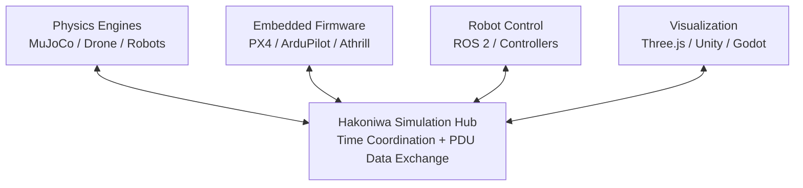

# Hakoniwa Lab 🏡

**Validate before the real world.**

https://github.com/user-attachments/assets/fafd84bd-c07b-4a85-87c3-03269dacc6b2

*Unmodified PX4 v1.17.0 runs on an emulated Pixhawk 4 ([Athrill](https://github.com/hakoniwalab/athrill-target-stm32)) and flies a simulated x500. A motor is stopped inside the emulated DShot ESC; PX4 detects the failure from the ESC telemetry with its own drivers.*

**New to Hakoniwa? → [Getting Started](https://github.com/hakoniwalab/hakoniwa-getting-started)**

Hakoniwa Lab, LLC develops lightweight, modular simulation and verification infrastructure for robotics, drones, and embedded systems.

**Hakoniwa is a simulation hub — not just another simulator.**

It connects heterogeneous physics engines, embedded firmware, robot controllers, sensors, and visualization tools through coordinated simulation time and PDU-based data exchange.

By combining independent components, Hakoniwa enables engineers to build, test, and validate complex systems before deploying them to physical hardware.

Our ecosystem includes open-source technologies, commercial solutions, and engineering services.

## How Hakoniwa Works

Hakoniwa supports both in-process and distributed simulation configurations, allowing components to be developed, replaced, and verified independently.

## What We Build

### Drone Simulation & Verification

Physics-based drone simulation, PX4/ArduPilot integration, sensor error modeling, control validation, and fault injection.

Related projects: [Sensor Adapter](https://github.com/hakoniwalab/hakoniwa-sensor-adapter) · [PX4 Control Adapter](https://github.com/hakoniwalab/hakoniwa-drone-control-adapter-px4)

### Embedded Firmware Simulation

Run unmodified flight-controller firmware on virtual microcontrollers, including RTOS execution, interrupts, DMA, peripheral drivers, and fault scenarios.

Related projects: [Athrill STM32](https://github.com/hakoniwalab/athrill-target-stm32) · [Athrill Studio](https://github.com/hakoniwalab/athrill-studio)

### Robot Simulation & ROS 2

Composable robot runtimes integrating MuJoCo physics, ROS 2 control, sensors, and actuators for mobile robots and manipulators.

Related projects: [Robot Runtime](https://github.com/hakoniwalab/hakoniwa-robot-runtime) · [MuJoCo Robots](https://github.com/hakoniwalab/hakoniwa-mujoco-robots)

### Distributed & Multi-System Simulation

Coordinated execution of multiple robots, vehicles, controllers, and simulation domains with explicit time and data coordination.

Related projects: [Core PRO](https://github.com/hakoniwalab/hakoniwa-core-pro) · [Conductor](https://github.com/hakoniwalab/hakoniwa-conductor) · [Urban Mobility](https://github.com/hakoniwalab/hakoniwa-urban-mobility)

## Explore Our Projects

**[Hakoniwa Business Pack](https://github.com/hakoniwalab/hakoniwa-business-pack)**

An AI-assisted catalog and recipe hub for discovering, composing, and reproducing simulation systems.

**[Athrill STM32](https://github.com/hakoniwalab/athrill-target-stm32)**

Unmodified PX4, ArduPilot and Zephyr firmware on emulated STM32 boards (Pixhawk 4 / 6C), with their RTOS, interrupts, DMA and drivers.

**[Hakoniwa Robot Runtime](https://github.com/hakoniwalab/hakoniwa-robot-runtime)**

Composable robot execution integrating MuJoCo, ROS 2 control, and Hakoniwa PDU.

**[Hakoniwa Urban Mobility](https://github.com/hakoniwalab/hakoniwa-urban-mobility)**

Multi-vehicle simulation in PLATEAU urban environments, combining drones, ground vehicles, and visualization.

## Foundation

The simulation infrastructure is built on reusable runtime and coordination technologies.

- [Hakoniwa Core (TOPPERS)](https://github.com/toppers/hakoniwa-core-cpp) — Open-source core simulation infrastructure.
- [Hakoniwa Core PRO](https://github.com/hakoniwalab/hakoniwa-core-pro) — Extended runtime capabilities and event-driven simulation.
- [Hakoniwa Conductor](https://github.com/hakoniwalab/hakoniwa-conductor) — Coordination across multiple simulation domains.

## Commercial Solutions

**[Hakoniwa Drone PRO](https://hakoniwa-lab.net/products/drone-license/)**

Advanced drone simulation and verification for professional development, including control integration, sensor modeling, and fault validation.

We also provide engineering support for integrating Hakoniwa into customer-specific simulation and verification environments.

## Connect With Us

We welcome technical collaboration, open-source contributions, and commercial partnerships.

**Website:** https://hakoniwa-lab.net/

**Email:** tmori@hakoniwa-lab.net

**日本語:** [箱庭ラボ公式サイト](https://hakoniwa-lab.net/)
